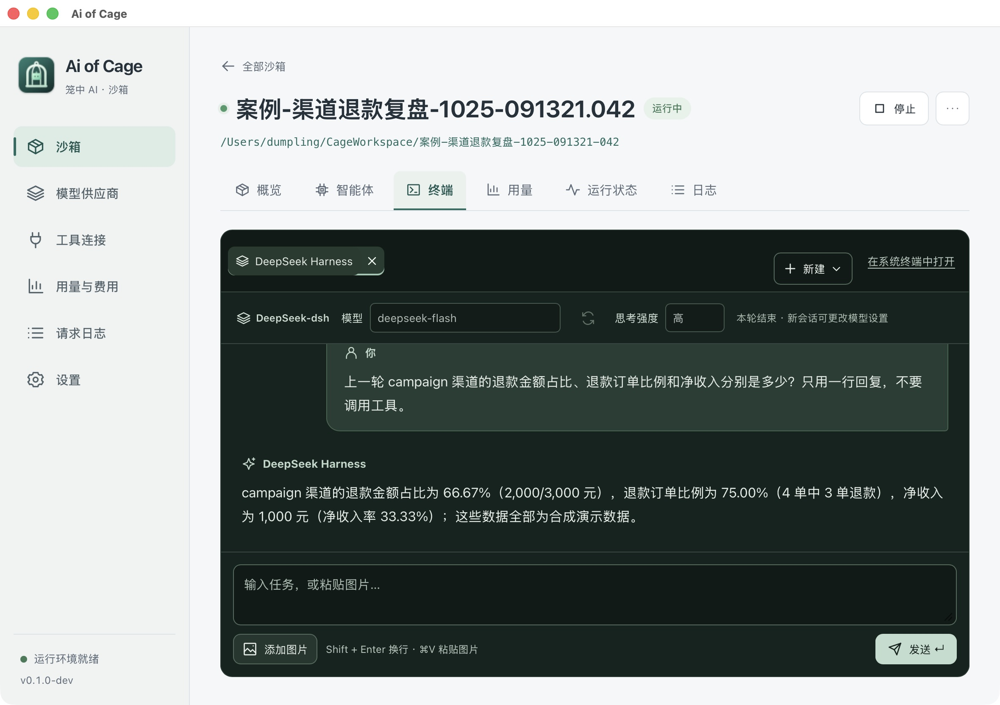

# 本轮交付与验收记录（2026-10-25）

本轮按独立方向提交堆叠 PR。桌面应用名称为 **Ai of Cage**，本机验收入口为仓库中的 `bin/Ai of Cage.app`，由 `make app` 构建；应用包不提交 Git。旧名称的其他工作树应用包不代表本轮最新实现。

## PR 与实现范围

| 顺序 | PR | 内容 |
| --- | --- | --- |
| 1 | [#37](https://github.com/shaoxier/AIofCage/pull/37) | 修复初始化文件与证书写入跟随符号链接的问题 |
| 2 | [#38](https://github.com/shaoxier/AIofCage/pull/38) | 统一名称，恢复 macOS 绿色全屏按钮，设置中增加全屏切换 |
| 3 | [#39](https://github.com/shaoxier/AIofCage/pull/39) | Agent 结构化会话、单一输入、分角色消息、模型/思考选择、统一新建菜单；官方 DeepSeek CLI |
| 4 | [#40](https://github.com/shaoxier/AIofCage/pull/40) | 公开价格目录、手动选择参考报价、自定义中转价与历史价格快照 |
| 5 | [#41](https://github.com/shaoxier/AIofCage/pull/41) | 官方版本检查、新沙箱默认、既有沙箱独立更新与失败恢复 |
| 6 | [#42](https://github.com/shaoxier/AIofCage/pull/42) | 三个业务 MCP 案例、官方 DeepSeek MCP 插件、录屏任务 |
| 7 | [#43](https://github.com/shaoxier/AIofCage/pull/43) | 查看并编辑专用 VM 的 CPU/内存/磁盘，空闲时停止环境 |
| 8 | [#44](https://github.com/shaoxier/AIofCage/pull/44) | 本机 stdio MCP 控制、隔离实验、供应商选择、额度与并发、跨进程锁 |
| 9 | 最终验收分支（本 PR） | 独立 Agent 回归、案例日期补齐、原生验收和资源测量 |

各 PR 依赖前一分支，按表中顺序审阅、合并。没有直接推送 main，也没有合并本轮 PR。

## 关键设计

DeepSeek Harness 本身提供官方 `@deepseek-ai/dsh` CLI，采用固定版本的 headless JSON 接口和官方 MCP 插件，不需要引入第三方包装。三种 Agent 的正文经 stdin 交付，不再向交互终端注入多行按键和粘贴序列；用户、回复、思考与工具分别显示。Shell 保留原生 xterm，只提供终端输入。模型与思考强度在会话首条消息确定，更改时新建会话；供应商是否接受该模型/档位取决于其接口。

版本检查与安装分离：选择新默认只影响后续新建沙箱。已有沙箱固定自己的 CLI 版本，用户在详情中决定更新；候选镜像准备成功后才替换容器，保留项目和 home。失败尝试恢复原配置与原运行快照，取消也保留原环境。

费用是按请求用量和所选单价计算的估算。参考 CC Switch 的公开目录和自定义报价思路，使用 models.dev 同名模型目录，保留来源、日期和自定义覆盖；中转折扣或非同名模型需要自行确认价格。没有价格/有效用量时显示未计价，CNY/USD 分开，未同步供应商真实账单或余额。

本机 AI 调用是按需 stdio MCP，不常驻、不开放 TCP 端口；父 Agent 可在自己的会话中选择另一供应商给实验沙箱使用。每次连接最多 8 个沙箱、16 项任务、2 项并发，创建额度只能在默认上限内调低。正常断开停止自己的任务和沙箱，保留项目与用量；不接管用户既有沙箱。完整工具和连接方式见[调用说明](../local-agent-control.md)。

可选资源设置已实现 CPU/内存/磁盘。工作区和应用数据路径继续展示实际位置，修改这两项需要迁移项目、挂载与权限，没有作为普通文本字段开放。用户原有 VM、供应商、默认版本与沙箱绑定没有被测试改写。

## 实际验证

| 项目 | 结果与证据 |
| --- | --- |
| 初始化安全 | 9 项 Python 安全回归及相关 Go 竞态通过，覆盖目标/父目录/证书链接与目录替换竞态。只确认修复 UID 1000 权限范围内的误写，没有把它等同于宿主逃逸 |
| 通用质量 | 全部 internal 包 Go 竞态、生产编译/vet、项目 JS 语法、10 项 Node 回归、差异空白检查通过；新提交凭据模式扫描无发现 |
| 三 CLI 协议 | 三个真实官方 CLI 对受控本地 SSE 上游均退出 0，原生会话 ID、模型和思考参数核对通过 |
| DeepSeek 真实会话 | 独立两轮暗号/原生会话 ID 回归通过；原生应用选择 deepseek-flash 和“高”思考强度，调用 MCP、写报告并续聊通过 |
| Claude 真实会话 | 拆分测试沙箱后，DeepSeek-CC 两轮暗号/原生会话 ID 在 6.79 秒通过 |
| Codex 真实供应商 | 未通过：七牛 `/v1/responses` 重试收到门卫 `upstream_failed` / 502，约每次 10 秒；宿主无凭据直连同域名也超时。当前连接条件下未完成真实上游续聊，不据此宣称供应商本身故障 |
| 版本迁移 | 真实 Codex 0.164.0 → 0.163.0、home 保留、不存在版本失败后旧容器仍运行、真实取消 2.64 秒后原环境完好 |
| MCP 案例 | 三独立沙箱的握手、工具发现、取数、统计、越权拒绝、会话关闭通过；日期补齐后重建连接器，真实 DeepSeek 再生成报告并核对指标/ID/合成声明，整组 40.03 秒 |
| 本机控制 | 真实两沙箱并发任务、Bash 工具执行中取消、标记进程清理、退出停止与持久用量通过；实际 cagectl 和桌面二进制 --mcp 握手、8 工具发现、作用域与 EOF 退出通过 |
| 多进程协调 | 三独立进程累计 60 次元数据更新不丢失；同一及独立 Manager 的沙箱锁都按超时退出 |
| 原生界面 | 新名称/Logo、绿色按钮全屏、设置退出全屏、官方版本检查、连接配置路径、统一新建菜单、单输入、分角色回复、Shell 仅终端输入通过 |
| VM 资源 | 实际读取与临时设置验证通过；有用户运行容器，跳过真实停止/重新分配 VM，未把受控命令夹具当作真实重分配成功 |

初次三 Agent 回归错误地共享请求额度，Codex 重试耗尽后影响后续 Claude。本 PR 将每种 Agent 拆成独立沙箱和独立额度，并在失败时仅输出门卫审计元数据。退款案例原生测试也发现任务日期缺少字段证据，现已补齐十条订单的 `order_date` 并通过真实 MCP 按日期读取检查。

原生会话截图来自真实 DeepSeek 请求，展示用户消息、回复、模型、思考强度与唯一输入区。此截图记录日期字段补齐前的那次原生验收；截图中的最后一轮指标与修正后数据一致。

## 轻量化实测

本机为 10 核、24 GiB 内存的 Apple Silicon Mac。以下是本轮夹具清理后的点时样本，不是并发峰值或最低硬件要求。

| 项目 | 观测值 | 口径 |
| --- | --- | --- |
| Ai of Cage.app | 31,476 KiB，约 30.7 MiB | 当前构建应用包，不含 Colima、Docker 和镜像 |
| 桌面主进程 RSS | 135,040 KiB，约 131.9 MiB | 原生操作后样本，不含 WebKit XPC 子系统 |
| VM 宿主进程 RSS | 688,848 KiB，约 672.7 MiB | 单次进程 RSS，不等同于全部虚拟机实际物理内存 |
| VM 配置 | 4 CPU / 6 GiB / 40 GiB | 分配配置和磁盘上限，磁盘按需增长 |
| 现有 Agent 容器 | CPU 0.02%，89.74 MiB | 空闲时；4 GiB 为容器限制 |
| 门卫 / 数据库连接器 | 6.27 MiB / 3.035 MiB | 两个容器分别计量 |
| 演示 PostgreSQL | 27.06 MiB | 与 Agent 分开计量 |
| Docker 镜像 | 61 个，共享计算 22.46 GB | 本机多轮开发的累计镜像，不是新安装所需体积 |
| 构建缓存 / 数据卷 | 12.23 GB / 1.215 GB | 累计开发缓存和现有数据，未执行 prune |

桌面壳的体积较小，完整运行环境仍有虚拟机、CLI 镜像和构建缓存成本。当前机器上的空闲 CPU 较低；模型工具执行、依赖安装和多个并发沙箱会提高占用。可以在设置中调整资源、在任务结束后停止沙箱，环境没有运行容器时再停止 VM。没有在 8/16 GiB 机器上验证，不能给出已实测的最低配置。

## 已知限制与验收入口

- 七牛真实 Codex 请求受当前连接条件限制；其余两种真实供应商会话通过。三 CLI 的协议适配已分别验证。
- 结构化消息目前不在应用重启后恢复，原生 CLI 历史保留在 home；新版三供应商识图全链路尚未完成。
- 真实 VM 重分配留待无运行容器时验收。强杀本机控制进程或系统崩溃不保证退出清理，可在桌面处理残留沙箱。
- 安全验证只覆盖所测路径，未把此次修复扩大为“防止全部容器逃逸”；费用仍是估算，案例全部为合成数据。

建议先创建 DeepSeek 案例体验：工具连接 → 案例库 → 创建案例沙箱 → 选供应商 → 启动 → 终端 → 新建智能体会话 → 复制并发送任务。录屏的三个方向与预期数据见[案例说明](../demo-cases.md)。更新旧沙箱后需停止并启动，使新版初始化和会话组件生效，项目与 home 保留。

一次性测试容器、网络、home 卷、项目以及原生验收创建的 MCP 配置均已清理，报告与截图留存。用户原有四个运行容器继续运行；没有重启用户 VM，也没有进行广泛 Docker 清理。各方向的细节见同目录逐项验证记录。
